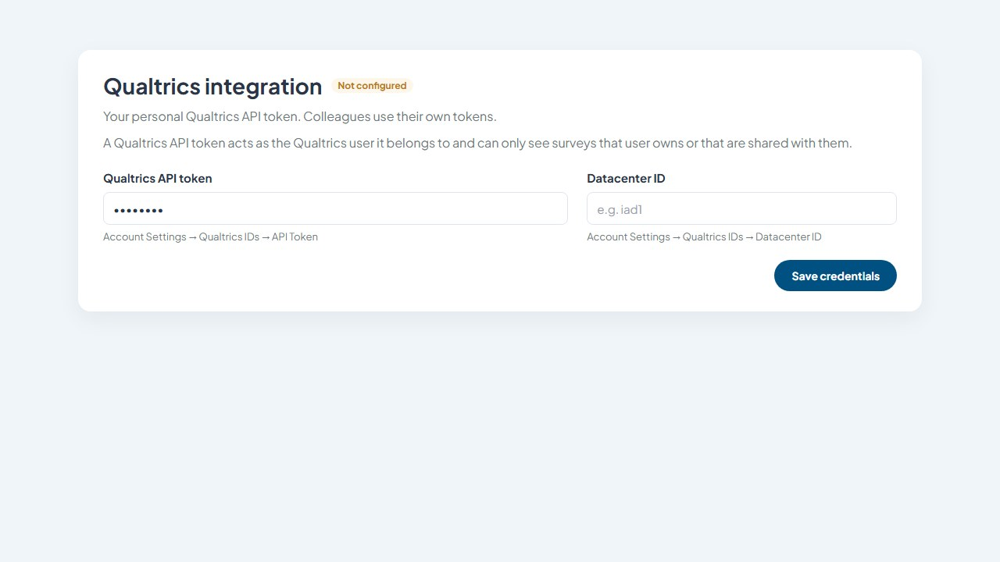
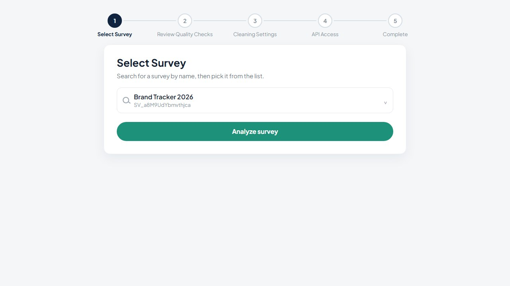
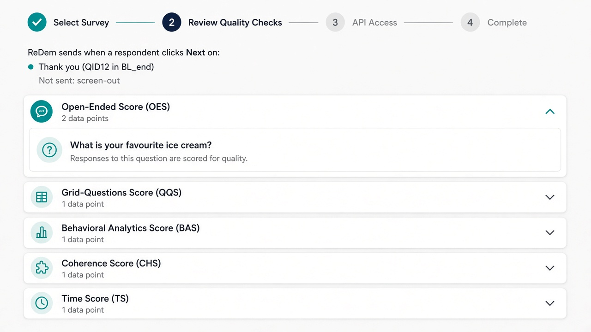
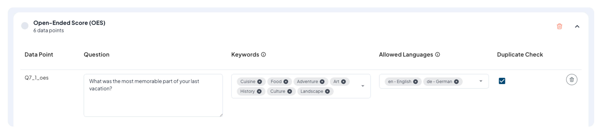
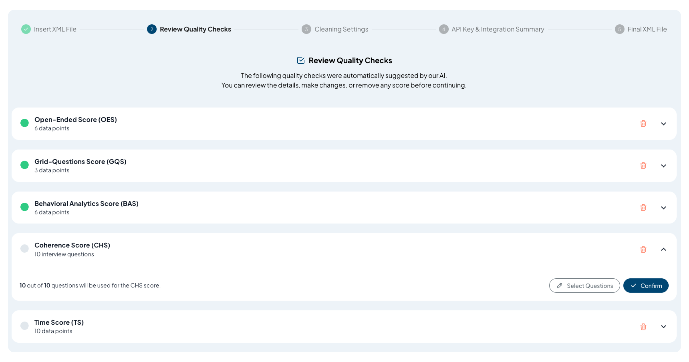
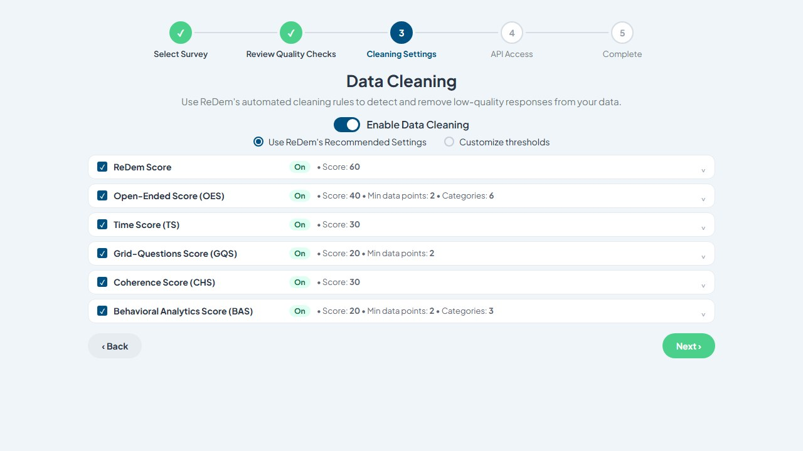
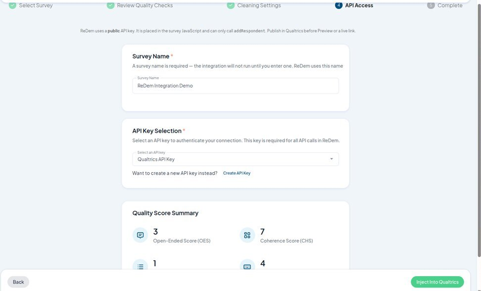
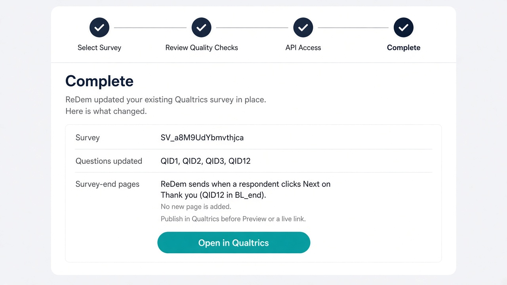

<video
  className="w-full aspect-video rounded-xl"
  controls
  playsInline
  src="https://redem-public.s3.eu-central-1.amazonaws.com/videos/qualtrics_integration_agent_narrated_v4.mp4"
  title="Qualtrics Integration Agent"
>
  <a href="https://redem-public.s3.eu-central-1.amazonaws.com/videos/qualtrics_integration_agent_narrated_v4.mp4">
    Watch the Qualtrics Integration Agent demo
  </a>
</video>

The Qualtrics Integration Agent connects an **existing** Qualtrics survey to ReDem. It writes quality-check scripts onto questions you already have. It does **not** create a new Qualtrics survey or add a new page.

When a respondent clicks **Next** on the last page of a completing path, the survey sends that interview to ReDem. Screen-outs, quota met, and other term exits are not sent.

<Note>
  Qualtrics integration is enabled per company. If you do not see **Integrations → Qualtrics**, ask your ReDem admin or [info@redem.io](mailto:info@redem.io) to turn it on.
</Note>

## What you need

- A ReDem user account in a company where Qualtrics integration is enabled
- **Qualtrics API** access on your Qualtrics brand, with **Access API** enabled for your Qualtrics user
- Your own Qualtrics **API token** and **Datacenter ID**
- A **public** ReDem API key (the wizard will not accept a private key)
- A Qualtrics survey that already has a visible last page on every completing path (for example a thank-you question). Completing paths that end inside a Loop & Merge block cannot be connected until you add a page after the loop.

## How it works

1. You pick the Qualtrics survey in ReDem.
2. ReDem reads the questionnaire and suggests quality checks for you to approve.
3. Cleaning is on by default with ReDem's recommended settings. You can customize them or turn cleaning off.
4. You choose a public API key and a unique ReDem survey name.
5. ReDem writes QuestionJS and embedded data into that Qualtrics survey in place.
6. You **publish** in Qualtrics. Preview and live links use the last published version, not the unpublished draft.
7. The ReDem survey is created when the **first completed interview** arrives, under the company of the public API key.

<Steps titleSize="h3">
    <Step title="Save your Qualtrics API token">
        Each ReDem user saves **their own** Qualtrics token. A token can only see surveys that Qualtrics user owns or that are shared with them. ReDem encrypts the token and does not show it again after save.

        1. In Qualtrics, open **Account Settings → Qualtrics IDs**.
        2. Copy your **API token** (generate one if you do not have it yet) and your **Datacenter ID** (for example `iad1` or `co1`).
        3. In ReDem, go to **Administration → Password & Security**.
        4. Expand **Qualtrics integration**, paste the token and datacenter, and click **Save credentials**.

        You can also start from **Integrations → Qualtrics** and click **Configure Qualtrics token**. That opens the same settings and returns you to the assistant after save.

        
    </Step>

    <Step title="Open the Qualtrics assistant">
        1. Log in to ReDem.
        2. In the sidebar, open **Integrations** and choose **Qualtrics**.

        The first step explains the flow and asks you to search for a survey. The assistant stays locked until a token is saved.
    </Step>

    <Step title="Select and analyze your survey">
        1. Type at least two characters of the survey **name**. Matching surveys appear as you type; the Qualtrics survey ID is shown as a subtitle.
        2. Pick the survey. ReDem will update **that** project in place.
        3. Click **Analyze survey**.

        
    </Step>

    <Step title="Review quality checks">
        ReDem suggests quality checks from the questionnaire. Suggestions are a starting point — review each score, adjust as needed, and confirm. Use **Confirm all** to approve every suggested check at once and continue. Every quality check on the list must be approved (or removed) before you continue.

        Only questions on pages with **one respondent-visible question** are suggested. Timing questions, text/graphics, Captcha, Meta, and always-hidden questions do not count toward that limit. Questions that share a page with another visible question are omitted from every score, including OES, GQS, CHS, BAS, and Time Score.

        The review step also lists the **survey-end pages** ReDem will send from, and any screen-out / quota / term exits that will **not** be sent.

        

        **Open-Ended Score (OES)**
        - Suggested for open-end questions that are alone on their page.
        - Add keywords (optional), set allowed languages (recommended), and turn duplicate detection on or off.
        - Remove any open ends you do not want scored.
        - Piped question or loop text is filled in per respondent when the survey is taken.

        

        **Grid-Questions Score (GQS)**
        - Suggested for grids that are alone on their page (typically 5 or more rows). Loop & Merge grids can be included with fewer rows.
        - Remove a grid if a straight-line pattern is an acceptable answer.
        - Confirm your selections.

        **Behavioral Analytics Score (BAS)**
        - Open ends are tracked for keystrokes. Grids are tracked for mouse movement.
        - Only suggested for questions that are alone on their page, so two mouse trackers never share the same page events.
        - Confirm alignment with the questions you care about.

        **Coherence Score (CHS)**
        - Includes visible questions that are alone on their page. Select or deselect as needed, then confirm.
        - You can select up to **300** questions. Loop & Merge can produce more answers than that; ReDem still sends at most 300 answers per respondent.

        

        **Time Score (TS)**
        - Uses the first **30** eligible pages in survey flow order. A page is eligible only if it has one respondent-visible question that is used for another quality check.
        - Questions inside Loop & Merge blocks are not timed.
        - Deselect pages you do not want timed, then confirm.
    </Step>

    <Step title="Set cleaning settings">
        Cleaning is **on by default**, pre-filled with ReDem's recommended thresholds for the quality checks you approved.

        1. Leave **Enable Data Cleaning** on to apply those rules to every interview Qualtrics sends.
        2. Use ReDem's recommended settings, or customize thresholds.
        3. Turn cleaning off if you do not want exclusion rules injected into the survey.

        

        These settings are written into the Qualtrics send payload. They are applied automatically when each complete arrives in ReDem. You can still change them later on the ReDem survey. See [Cleaning and review](/knowledge-base/features/cleaning-and-review).
    </Step>

    <Step title="Choose a survey name and a public API key">
        1. Enter a **unique** ReDem survey name (letters, numbers, spaces, hyphens, and underscores). The ReDem survey is **not** created in this step — it appears when the first complete arrives.
        2. Select a **public** ReDem API key. That key is placed in the survey JavaScript and can only call `addRespondent`.
        3. Review the summary of confirmed quality checks.

        

        Click **Inject into Qualtrics**.
    </Step>

    <Step title="Publish in Qualtrics">
        After a successful inject you will see which questions were updated and which existing pages send to ReDem. No new Qualtrics page is added.

        

        1. Click **Open in Qualtrics** to jump to the survey editor.
        2. **Publish** the survey in Qualtrics.
        3. Use Preview or your live link **after** publishing. Those use the last published version, not the unpublished draft.

        A redirect after the last **Next** is fine.
    </Step>

    <Step title="Send a test complete and review in ReDem">
        1. Take the published survey and complete it (click **Next** on the last page of a completing path).
        2. Do **not** use a screen-out or quota-met exit for this test — those are not sent.
        3. In ReDem, open the new survey (named as you entered in the wizard) and review the interview.
    </Step>

    <Step title="Re-run the assistant on the same survey">
        You can inject again after changing quality checks or the survey structure.

        Each run replaces ReDem QuestionJS that this assistant previously wrote (`/* REDEM:BEGIN */` … `/* REDEM:END */`). Existing customer QuestionJS on those questions is kept. You do not need to strip the old ReDem scripts by hand.

        Publish again in Qualtrics after a re-inject.
    </Step>
</Steps>

## Limits (current version)

| Topic | Behavior |
| --- | --- |
| Completing paths | Every complete must end on a page that can run JavaScript. The wizard refuses if a completing End Survey has no such page, or if that page is inside Loop & Merge. |
| Screen-outs and terms | Not sent. |
| Last-page drop-off | Not sent. The respondent must click **Next** on the survey-end page. |
| Speeder / complete logic **after** that last Next | Still sent in this version. Qualtrics decisions that happen after the last page are not visible to the in-survey send. |
| Time Score | First 30 eligible non-loop pages in flow order. Pages with more than one visible question are not timed. |
| Coherence Score | Up to 300 interview answers per respondent. Only questions alone on a page are suggested. |
| Behavioral Analytics | Long mouse/keystroke payloads are trimmed so the browser can send them on page leave. Mouse tracking is not suggested when two visible questions share a page. |
| Multi-question pages | Questions that share a page with another visible question are not suggested and do not get quality-check QuestionJS. Send / `addRespondent` may still land on the survey-end page. |

<Note>
  **Important notes**
  - This assistant is a starting point. Always review suggested checks and take a test complete after publish.
  - Use a **public** ReDem API key only. Do not put a private key in QuestionJS.
  - Each colleague uses their own Qualtrics token. They will only see surveys Qualtrics shares with them.
  - Qualtrics API access is a brand feature. A Brand Administrator must enable **Access API** for each user who injects.
</Note>
